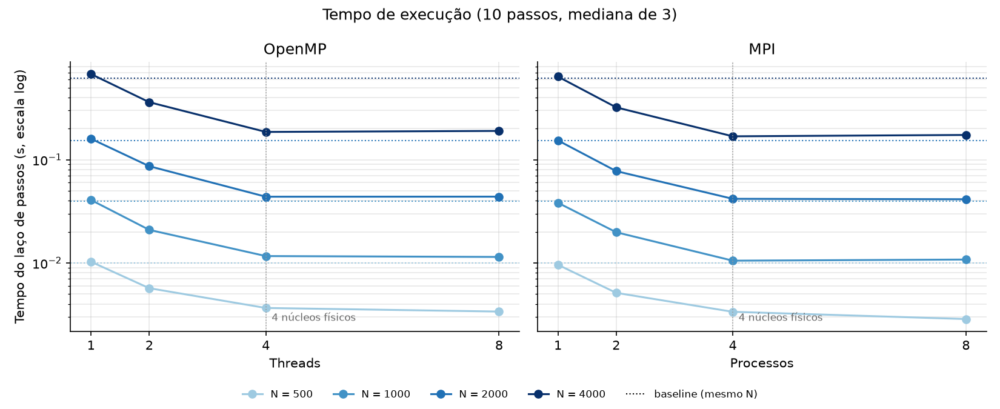
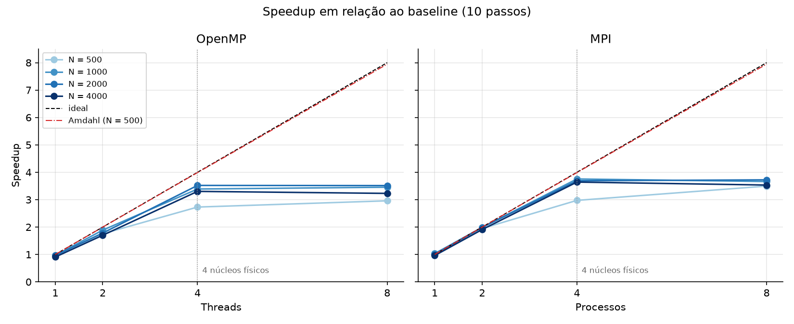
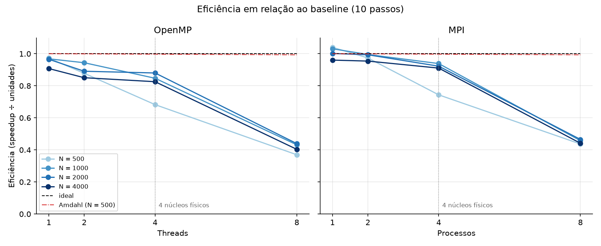
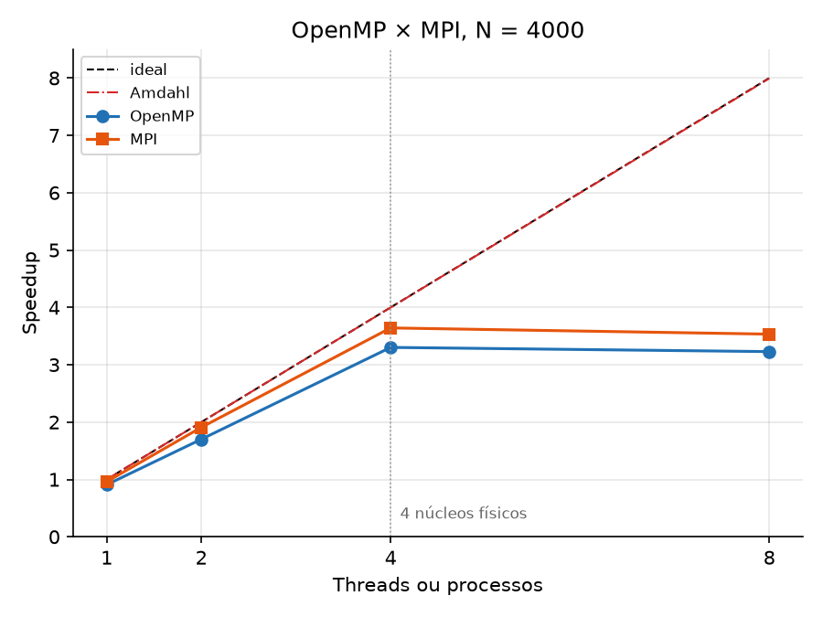
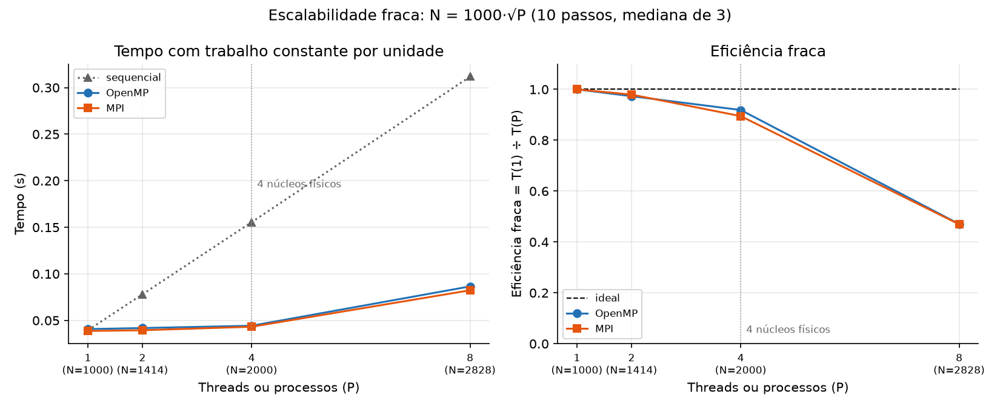

# Resultados

Todos os arquivos desta pasta são gerados pelos scripts em `scripts/`, pelos alvos do `make`. Em cada CSV de medição:

- cada linha é uma execução;
- a coluna `descartada` marca a 1ª execução de cada configuração, que é aquecimento;
- o valor de cada configuração é a **mediana das 3 linhas com `descartada = nao`**.

## Arquivos

| Arquivo | Gerado por | O que tem |
|---|---|---|
| `baseline_06_nbody_mesma_sessao.csv` | `make medir` | sequencial, N = 500 a 4000, medido na mesma sessão do OpenMP e do MPI. **Use este para o speedup.** |
| `openmp_06_nbody.csv` | `make medir` | OpenMP com 1, 2, 4 e 8 threads |
| `mpi_06_nbody.csv` | `make medir` | MPI com 1, 2, 4 e 8 processos, com o tempo de comunicação |
| `maquina.txt` | `make medir` | máquina, ambiente, afinidade e temperatura no início de cada N |
| `fraca_baseline_06_nbody.csv`, `fraca_openmp_06_nbody.csv`, `fraca_mpi_06_nbody.csv` | `make fraca` | escalabilidade fraca: N = 1000·√P. A coluna `threads`/`processos` é o P de cada N. |
| `maquina_fraca.txt` | `make fraca` | o mesmo, para a sessão da escalabilidade fraca |
| `perfil_06_nbody.csv`, `maquina_perfil.txt` | `make perfil` | tempo de cada trecho do sequencial (ver [`baseline/README.md`](../baseline/README.md)) |
| `validacao_openmp.csv`, `validacao_mpi.csv` | `make validar`, `make validar-mpi` | comparação com o baseline em precisão total: 72 de 72 e 30 de 30 iguais |
| `schedule_06_nbody.csv` | `make schedule` | comparação de `static`, `dynamic` e `guided` no OpenMP (ver [`openmp/README.md`](../openmp/README.md)). Medido antes da padronização, fora do contêiner oficial. |
| `speedup_eficiencia.csv` | `make graficos` | speedup, eficiência e previsão de Amdahl de cada N e de cada versão, calculados das medianas de `make medir` e do `make perfil` |
| `grafico_tempo.png`, `grafico_speedup.png`, `grafico_eficiencia.png`, `grafico_openmp_vs_mpi.png` | `make graficos` | gráficos da seção [Speedup e eficiência](#speedup-e-eficiência-make-graficos) |
| `escalabilidade_fraca.csv`, `grafico_escalabilidade_fraca.png` | `make graficos` | tempo e eficiência fraca calculados dos CSVs do `make fraca` |
| `baseline_06_nbody.csv` | Marco 1 | sequencial medido em setembro, em outra sessão. Fica como histórico e **não** entra no speedup. |

Tudo, menos o `schedule` e o do Marco 1, foi medido no contêiner oficial da disciplina (`iesb/pp-lab:2026.2`). A máquina é um Intel i7-8550U com 4 núcleos físicos (`nproc` = 8). O protocolo é o mesmo em todos os casos:

- 4 execuções por configuração, a 1ª descartada;
- espera o processador esfriar até 55 °C antes de cada tamanho;
- configurações do mesmo tamanho intercaladas;
- uma thread ou processo por núcleo físico.

## Escalabilidade fraca (`make fraca`)

Na escalabilidade **forte** (`make medir`), o problema fica do mesmo tamanho e o número de threads ou processos aumenta. Na **fraca**, o problema cresce junto com P, para cada thread ou processo ter sempre o mesmo trabalho. Se o tempo continuar igual, a escalabilidade é perfeita.

Como o cálculo de forças custa N² por passo, o trabalho por thread ou processo fica constante com **N = 1000·√P**:

| P | 1 | 2 | 4 | 8 |
|---|---:|---:|---:|---:|
| N | 1000 | 1414 | 2000 | 2828 |
| N² ÷ P | 1,00·10⁶ | 1,00·10⁶ | 1,00·10⁶ | 1,00·10⁶ |

Eficiência fraca = T(1, 1000) ÷ T(P, 1000·√P), comparando cada versão com ela mesma rodando com 1 thread ou processo. O ideal é 1.

Medianas, em segundos. Os 4 blocos começaram com o processador a 55 °C ou menos, e todas as execuções deram o checksum do baseline com o mesmo N:

| P | N | Sequencial | OpenMP | Eficiência OpenMP | MPI | Comunicação MPI | Eficiência MPI |
|---:|---:|---:|---:|---:|---:|---:|---:|
| 1 | 1000 | 0,0394 | 0,0407 | 1,000 | 0,0387 | 0,000001 | 1,000 |
| 2 | 1414 | 0,0781 | 0,0418 | 0,973 | 0,0395 | 0,00019 | 0,980 |
| 4 | 2000 | 0,1555 | 0,0443 | 0,919 | 0,0432 | 0,0019 | 0,895 |
| 8 | 2828 | 0,3118 | 0,0865 | 0,470 | 0,0824 | 0,0010 | 0,469 |

**O tamanho escolhido realmente multiplica o trabalho por P.** O tempo do sequencial cresce 1,98×, 3,95× e 7,92× para P = 2, 4 e 8.

**Speedup escalado.** É o tempo do sequencial no N de cada P dividido pelo tempo da versão paralela:

| P | OpenMP | MPI |
|---:|---:|---:|
| 2 | 1,87× | 1,98× |
| 4 | 3,51× | 3,60× |
| 8 | 3,60× | 3,79× |

### O que os números mostram

- **Até 4 threads ou processos, a escalabilidade fraca é boa: eficiência de 0,90 a 0,98.** O tempo quase não muda enquanto o problema e o número de núcleos crescem juntos.
- **A queda com P = 4 vem de dois lugares.** Com os 4 núcleos ocupados, o processador baixa a frequência para caber no limite de potência. No MPI, o `Allgatherv` também cresce: cada processo recebe as posições de todas as N partículas, e N cresceu. A comunicação passa a ser 4,4% do tempo.
- **Com P = 8, a eficiência cai para 0,47.** A máquina tem só 4 núcleos físicos. As 8 threads dividem 4 unidades de ponto flutuante, então a capacidade de conta é a mesma de P = 4. O trabalho dobra e o tempo também (0,0443 → 0,0865 s no OpenMP). Contando só os 4 núcleos físicos, a eficiência equivale a cerca de 0,94.
- **Lei de Gustafson.** Ela diz que, quando o problema cresce com P, o speedup escalado é P − α·(P − 1), onde α é a fração serial. Pelo [perfilamento](../baseline/README.md), α fica abaixo de 0,1%, então a previsão é praticamente P. Os valores medidos até 4 (1,9× a 2,0× com 2 e 3,5× a 3,6× com 4) ficam perto disso. A diferença vem do hardware (frequência e hyper-threading), não do código.

## Speedup e eficiência (`make graficos`)

Calculados a partir das medianas de `make medir`, que mediu baseline, OpenMP e MPI na mesma sessão e na mesma máquina:

- **Speedup** = tempo do baseline ÷ tempo da versão paralela
- **Eficiência** = speedup ÷ número de threads ou processos
- **Amdahl:** S(p) = 1 ÷ ((1 − P) + P ÷ p), com a fração paralelizável P de cada N medida pelo `make perfil` (de 0,99903 com N = 500 a 0,99988 com N = 4000)

O `make graficos` instala o `matplotlib` no contêiner se ele faltar, gera os 5 gráficos, o `speedup_eficiencia.csv` e o `escalabilidade_fraca.csv`, e imprime a tabela abaixo.

| N | Versão | S(1) | S(2) | S(4) | S(8) | E(2) | E(4) | E(8) |
|---:|---|---:|---:|---:|---:|---:|---:|---:|
| 500 | OpenMP | 0,97× | 1,76× | 2,73× | 2,96× | 0,88 | 0,68 | 0,37 |
| 500 | MPI | 1,04× | 1,95× | 2,97× | 3,50× | 0,97 | 0,74 | 0,44 |
| 1000 | OpenMP | 0,97× | 1,89× | 3,39× | 3,46× | 0,94 | 0,85 | 0,43 |
| 1000 | MPI | 1,03× | 1,99× | 3,76× | 3,66× | 1,00 | 0,94 | 0,46 |
| 2000 | OpenMP | 0,97× | 1,78× | 3,52× | 3,51× | 0,89 | 0,88 | 0,44 |
| 2000 | MPI | 1,00× | 1,99× | 3,69× | 3,72× | 0,99 | 0,92 | 0,47 |
| 4000 | OpenMP | 0,91× | 1,70× | 3,30× | 3,23× | 0,85 | 0,83 | 0,40 |
| 4000 | MPI | 0,96× | 1,91× | 3,64× | 3,53× | 0,95 | 0,91 | 0,44 |

A previsão de Amdahl é praticamente o ideal em todos os casos: 1,998× a 2,000× com 2, 3,988× a 3,999× com 4 e 7,946× a 7,993× com 8.

No gráfico de tempo, as linhas pontilhadas são o baseline de cada N. A escala é logarítmica porque N = 4000 leva cerca de 60 vezes mais que N = 500. Isso confirma o O(N²): dobrar N multiplica o tempo por cerca de 4.

### O que os gráficos mostram

- **Até 4 threads ou processos, os dois escalam bem.** Com N ≥ 1000, a eficiência fica entre 0,83 e 0,94 no OpenMP e entre 0,91 e 1,00 no MPI.
- **A distância para Amdahl não vem do código.** A parte serial é menor que 0,1%, então Amdahl prevê quase o ideal. O que falta vem de custos que a lei não inclui: abrir e fechar regiões paralelas, comunicação e queda de frequência com todos os núcleos ocupados (ver [`baseline/README.md`](../baseline/README.md#fração-paralelizável-e-lei-de-amdahl)).
- **Com 8, o speedup para em cerca de 3,5×.** A máquina tem 4 núcleos físicos. A 5ª à 8ª threads ou processos dividem os mesmos núcleos com os 4 primeiros, então a eficiência cai pela metade (0,37 a 0,47).
- **N = 500 escala pior.** Há pouco trabalho por passo, e o custo fixo de dividir o trabalho pesa mais. Com 4, o speedup é 2,7× a 3,0×, contra 3,3× a 3,8× nos outros tamanhos.
- **O MPI ficou um pouco à frente do OpenMP.** Com 4 e N = 4000, foram 3,64× contra 3,30×. Cada processo MPI tem a própria memória e não disputa linha de cache com os outros; o OpenMP abre e fecha duas regiões paralelas a cada passo e já é 3% a 10% mais lento com 1 thread.

### Escalabilidade fraca em gráfico

À esquerda, o sequencial dobra de tempo a cada vez que P dobra, porque o trabalho total cresce com P. O OpenMP e o MPI ficam quase parados até P = 4, porque o trabalho por núcleo é o mesmo. À direita está a eficiência fraca da tabela da seção [Escalabilidade fraca](#escalabilidade-fraca-make-fraca), com os números em `escalabilidade_fraca.csv`.

## Por que o ganho real fica abaixo de Amdahl

A Lei de Amdahl prevê 3,99× com 4 e 7,99× com 8, porque a parte serial do código é menor que 0,1%. As medições ficam em 3,3× a 3,8× com 4 e em cerca de 3,5× com 8. Das causas que o enunciado manda discutir, esta é a situação de cada uma:

| Causa | Afeta este programa? | Evidência |
|---|---|---|
| **Overhead de comunicação e sincronização** | Sim, pouco | MPI: o `Allgatherv` é no máximo 1,3% do tempo com N = 4000 (seção de medições do [`mpi/README.md`](../mpi/README.md#medição-padronizada-make-medir)). OpenMP: abrir e fechar duas regiões paralelas e as barreiras a cada passo deixam a versão com 1 thread 3% a 10% mais lenta que o baseline (S(1) de 0,91× a 0,97×). |
| **Desbalanceamento de carga** | Não | Toda partícula `i` percorre os mesmos N corpos, então cada thread ou processo recebe o mesmo trabalho. Por isso o `static` é o melhor escalonamento e os blocos do MPI têm tamanho igual (no máximo uma partícula de diferença). |
| **False sharing** | Só com escalonamento errado | Com `dynamic` ou `static,1`, `fx[i]` e `fx[i+1]` ficam em threads diferentes na mesma linha de cache de 64 bytes, e o programa fica 7× a 13× mais lento ([`openmp/README.md`](../openmp/README.md#escalonamento-do-laço-de-forças-make-schedule)). Com o `static` padrão, cada thread grava um bloco contínuo e o efeito só aparece nas fronteiras entre blocos. |
| **Limite de banda de memória** | Não | Ver abaixo. |
| **Hardware: núcleos físicos e frequência** | Sim, é a causa principal | Com 8, a 5ª à 8ª threads ou processos dividem os 4 núcleos físicos com as 4 primeiras (hyper-threading), e a eficiência cai para 0,37 a 0,47. Com os 4 núcleos ocupados, o processador baixa a frequência para caber no limite de potência ([`baseline/README.md`](../baseline/README.md#fração-paralelizável-e-lei-de-amdahl)). |

### Por que a banda de memória não é o limite

O programa é limitado por **cálculo**, não por memória:

- **Os dados cabem no cache.** Cada partícula usa 7 `double`: `x`, `y`, `vx`, `vy`, `m`, `fx` e `fy`. São 56 bytes por partícula. Com N = 4000, o total é 4000 × 56 B = 224 KB. O laço de forças só lê `x`, `y` e `m`, ou seja, 3 × 4000 × 8 B = 96 KB, que cabem no cache L2 de 256 KB de cada núcleo do i7-8550U (o L3 compartilhado tem 8 MB). Depois do primeiro passo, os dados não voltam a ser buscados na memória principal.
- **Muita conta por byte lido.** Cada par (i, j) lê 3 `double` (24 bytes) e faz 17 operações de ponto flutuante, entre elas duas divisões e uma raiz quadrada, que são as instruções mais lentas do processador. O gargalo é a unidade de ponto flutuante, não o barramento.
- **A escalabilidade fraca confirma.** Até P = 4, o trabalho por núcleo fica constante e o tempo também (eficiência fraca de 0,90 a 0,98), mesmo com N e os dados crescendo. Se a banda fosse o limite, mais núcleos lendo ao mesmo tempo disputariam o barramento e a eficiência cairia já com P = 2.

A banda de memória só passaria a pesar quando os dados não coubessem mais no L3: 8 MB ÷ 56 B ≈ 150 mil partículas, bem acima dos N medidos. Isso é uma estimativa a partir do tamanho dos dados e do cache; a banda não foi medida diretamente.
